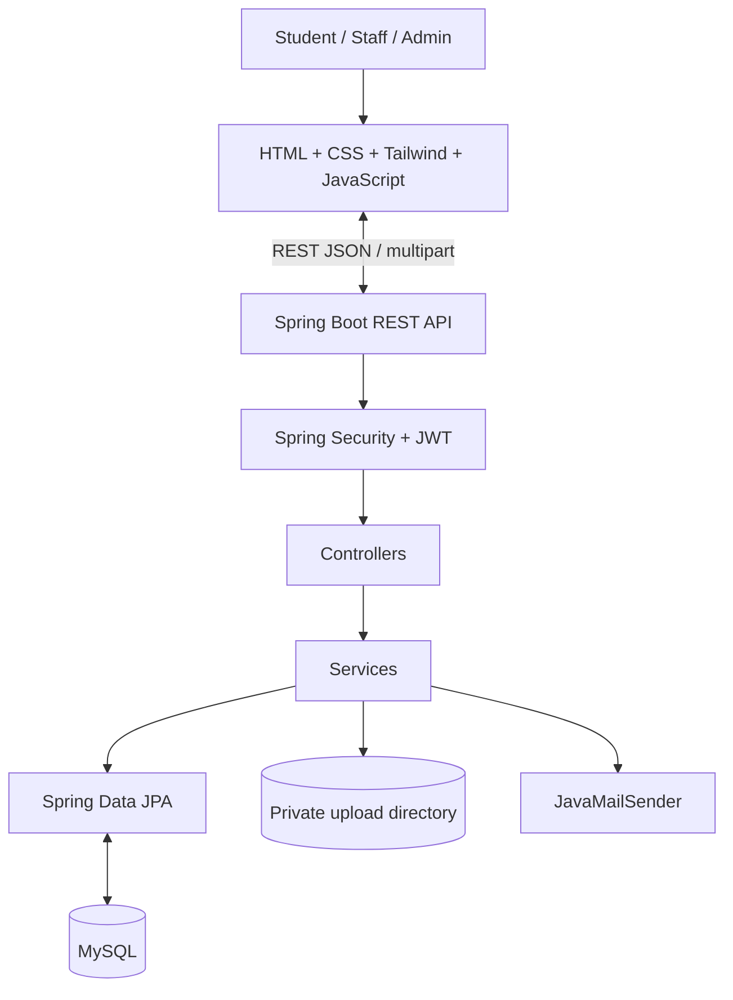
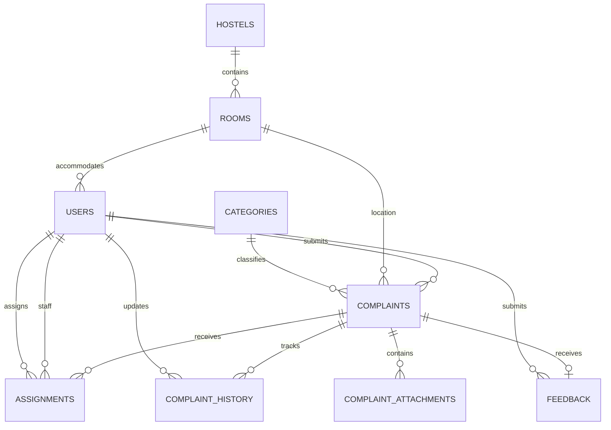

# HostelCare Architecture

## Overview

HostelCare is a three-tier application. Browser pages are implemented with HTML/CSS/vanilla JavaScript and call Spring Boot REST endpoints. The application tier authenticates users, enforces roles and complaint ownership, applies workflow rules, stores records through Spring Data JPA, manages attachment files and sends optional notifications. MySQL stores the nine core relational entities.

## Layers

- **Presentation:** `frontend/index.html`, `frontend/css/style.css`, `frontend/js/api.js`, `frontend/js/app.js`.
- **Application:** `backend/src/main/java/com/hostelcare/controller`, `service`, `config`, `dto`, `exception`.
- **Data:** `entity`, `repository`, and `database/hostelcare_schema.sql`.

Controllers accept validated DTOs and map entities into response maps; they do not return password hashes. Services enforce ownership and state transitions. Repositories own persistence queries.

## Roles

| Operation | STUDENT | STAFF | ADMIN |
|---|---:|---:|---:|
| Register | Yes | No | No |
| Submit complaint | Yes | No | No |
| View own complaint | Yes | No | Yes |
| View all complaints | No | No | Yes |
| Set priority / assign staff | No | No | Yes |
| View assigned tasks | No | Yes | Yes |
| Update assigned work status | No | Yes | Admin correction access |
| Submit feedback | Own resolved complaint | No | No |
| Manage hostel data / reports | No | No | Yes |

## Data model

Tables: `users`, `hostels`, `rooms`, `categories`, `complaints`, `assignments`, `complaint_attachments`, `complaint_history`, `feedback`.

## Complaint lifecycle

Normal path: `SUBMITTED → ASSIGNED → IN_PROGRESS → RESOLVED → CLOSED`.

A student can request `REOPENED` from `RESOLVED`. An administrator may reject an invalid or duplicate complaint; rejection reason should be supplied as an audit remark when that workflow is enabled. Each implemented status transition is stored in `complaint_history`. Reassignment deactivates the previous assignment and inserts a new active assignment row.

## Authentication

Student registration always assigns `STUDENT` on the server. Admin and staff are provisioned by an administrator or the optional environment-driven bootstrap administrator. Login verifies BCrypt and returns a signed JWT with expiry. The browser sends `Authorization: Bearer <token>` and keeps it in `sessionStorage` for this demonstration. Backend security is authoritative; hiding a frontend navigation item is not an authorization control.

## File storage and email

Image metadata is persisted in MySQL. Image bytes are written to `UPLOAD_DIR`, outside the public frontend. Access is checked against complaint ownership or active staff assignment. Email is optional and controlled by SMTP environment variables. Mail failures are swallowed so a mail outage does not erase a successfully stored complaint.
