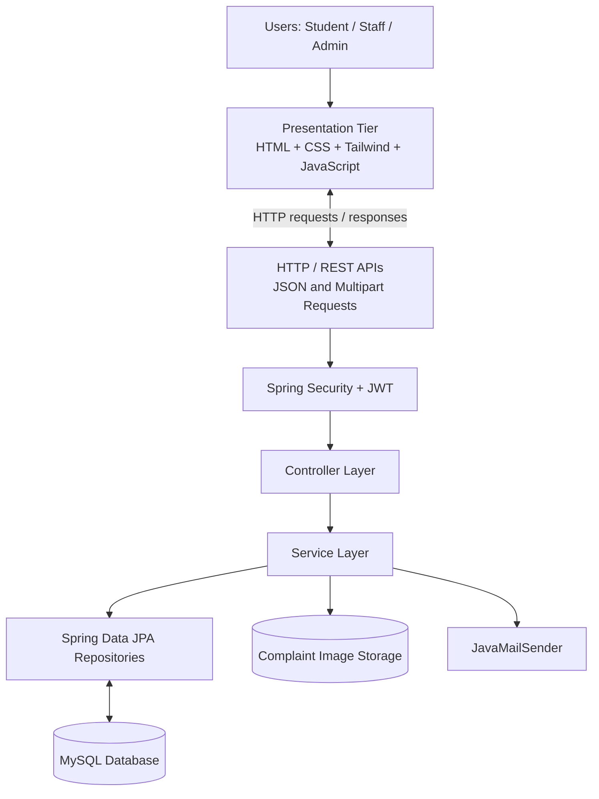
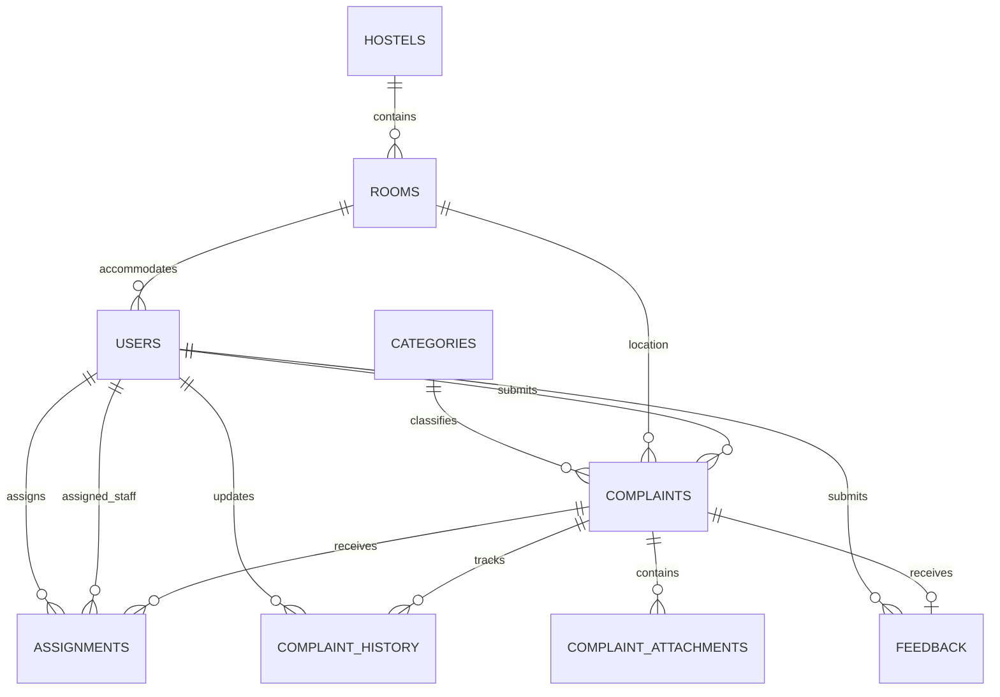
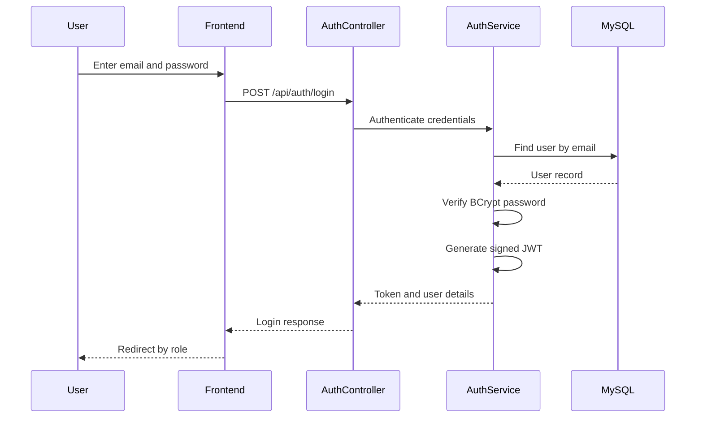

# HostelCare --- Hostel Complaint and Maintenance Management Portal

**Project type:** Full-stack web application\
**Version:** 1.0\
**Status:** Finalized project plan and architecture\
**Frontend:** HTML5, CSS3, JavaScript, Tailwind CSS\
**Backend:** Java, Spring Boot, Spring Security, JWT\
**Database:** MySQL\
**Supporting tools:** Maven, Spring Data JPA/Hibernate, JavaMailSender,
Postman, Git and GitHub

------------------------------------------------------------------------

## 1. Project overview

HostelCare is a centralized web-based hostel maintenance and complaint
management portal. It allows students to register maintenance complaints
and track their progress, maintenance personnel to process assigned
tasks, and administrators or wardens to manage complaints, assign
workers, monitor resolution and generate reports.

### 1.1 Problem statement

Hostel maintenance complaints are often communicated through phone
calls, messaging applications, verbal communication or physical
registers. These methods can make it difficult to track complaints,
prioritize urgent issues, assign the correct maintenance personnel and
maintain a reliable history of completed work.

HostelCare addresses these problems through a centralized application
with role-based access, complaint tracking, staff assignment, email
notifications, image attachments, student feedback and administrative
reports.

### 1.2 Project objectives

-   Provide a single portal for hostel maintenance complaints.
-   Allow students to register and track their own complaints.
-   Allow administrators to review complaints, set priority and assign
    staff.
-   Allow maintenance personnel to view and update their assigned tasks.
-   Maintain complaint status and assignment history.
-   Notify relevant users through email when important events occur.
-   Collect student feedback after maintenance work.
-   Provide reports that help administrators understand complaint trends
    and workload.

### 1.3 Users and roles

  -----------------------------------------------------------------------
  Role                                Responsibilities
  ----------------------------------- -----------------------------------
  `STUDENT`                           View profile and room details,
                                      register complaints, attach images,
                                      track complaints and submit
                                      feedback.

  `STAFF`                             View assigned complaints, inspect
                                      details and attachments, update
                                      work status and add resolution
                                      remarks.

  `ADMIN`                             Manage users and hostel data,
                                      review all complaints, set
                                      priority, assign staff and view
                                      reports.
  -----------------------------------------------------------------------

Admin and staff accounts should be created by an administrator or
through controlled database seeding. Public registration is intended for
students only.

------------------------------------------------------------------------

## 2. Finalized scope

### 2.1 Features included in version 1.0

#### Student module

-   Student registration and login.
-   View profile, hostel and room information.
-   Register a maintenance complaint.
-   Select a complaint category.
-   Enter a title and problem description.
-   Upload complaint photographs.
-   View personal complaint history.
-   Track complaint status and assignment information.
-   Receive email notifications.
-   Close a resolved complaint or request reopening when the issue
    persists.
-   Submit one feedback rating and optional comment after resolution.

#### Maintenance staff module

-   Staff login.
-   View complaints assigned to the logged-in staff member.
-   View complaint details, location and uploaded images.
-   Update complaint status according to permitted transitions.
-   Add work and resolution remarks.
-   View assigned and completed work history.

#### Admin / warden module

-   Admin login and dashboard.
-   View all complaints.
-   Filter complaints by status, priority, category, hostel and date.
-   Set complaint priority manually.
-   Assign or reassign maintenance personnel.
-   Manage students and staff accounts.
-   Manage hostels, rooms and complaint categories.
-   Monitor complaint progress.
-   View reports and analytics.
-   Export report data as CSV.

#### Supporting features

-   Email notifications using Spring Boot `JavaMailSender`.
-   Complaint image uploads using multipart requests.
-   Complaint status history.
-   Feedback and ratings.
-   Reports generated from database queries.

### 2.2 Explicitly excluded from version 1.0

-   Automatic staff assignment.
-   Automatic or AI-based priority determination.
-   AI-based complaint classification.
-   WhatsApp or SMS notifications.
-   Mobile application.
-   Real-time chat.
-   Predictive maintenance or IoT integration.

These may be considered as future extensions after the core workflow is
complete.

------------------------------------------------------------------------

## 3. Technology stack

  -----------------------------------------------------------------------
  Layer / purpose         Technology              Reason for use
  ----------------------- ----------------------- -----------------------
  Page structure          HTML5                   Defines application
                                                  pages and forms.

  Styling                 CSS3                    Custom visual styling.

  Responsive UI           Tailwind CSS            Utility-first
                                                  responsive design.

  Frontend logic          JavaScript              Form validation, page
                                                  interactions and API
                                                  calls.

  Backend                 Java + Spring Boot      REST API and
                                                  application logic.

  Authentication          Spring Security + JWT   Authentication and
                                                  role-based
                                                  authorization.

  ORM                     Spring Data JPA /       Maps Java entities to
                          Hibernate               relational tables.

  Database                MySQL                   Persistent relational
                                                  storage.

  Password hashing        BCrypt                  Secure password
                                                  hashing.

  Email                   Spring Boot             Sends event-triggered
                          JavaMailSender          email notifications.

  File handling           Spring Boot             Accepts complaint image
                          MultipartFile           uploads.

  Build                   Maven                   Dependency and build
                                                  management.

  API testing             Postman                 Tests REST endpoints
                                                  and authorization.

  Version control         Git + GitHub            Tracks source code and
                                                  supports collaboration.

  Charts                  Chart.js                Displays report
                                                  visualizations.
  -----------------------------------------------------------------------

The frontend will be a multi-page application using plain HTML, CSS,
JavaScript and Tailwind CSS. It will communicate with Spring Boot
through REST APIs using `fetch()`. React is not required.

### 3.1 Suggested development environment

  -----------------------------------------------------------------------
  Setting                             Selection
  ----------------------------------- -----------------------------------
  Java                                JDK 21

  Spring Boot                         A compatible stable 3.x release

  Build tool                          Maven

  Packaging                           JAR

  Database                            MySQL 8.x

  Backend port                        8080

  API data format                     JSON

  Frontend development                Static files served locally or
                                      through a simple development server
  -----------------------------------------------------------------------

Use compatible dependency versions selected by Spring Initializr. Do not
mix incompatible Spring Boot, Java or JWT library versions.

------------------------------------------------------------------------

## 4. Three-tier system architecture

HostelCare follows a three-tier architecture.

### 4.1 Presentation tier

**Technologies:** HTML5, CSS3, Tailwind CSS and JavaScript.

Responsibilities:

-   Display login, registration and dashboard pages.
-   Collect and validate user input.
-   Show complaints, status timelines and reports.
-   Send HTTP requests to backend REST APIs.
-   Display success and error messages.
-   Render charts using report API data.

### 4.2 Application tier

**Technologies:** Java, Spring Boot, Spring Security, JWT and Spring
Data JPA.

Responsibilities:

-   Expose REST APIs.
-   Authenticate users and authorize requests by role.
-   Validate incoming data.
-   Enforce complaint workflow and business rules.
-   Assign complaints and update status.
-   Store and retrieve data through repositories.
-   Handle image uploads.
-   Send email notifications.
-   Generate report data.

### 4.3 Data tier

**Technology:** MySQL.

Responsibilities:

-   Store users, hostels, rooms and categories.
-   Store complaints and assignments.
-   Store attachment metadata.
-   Maintain complaint status history.
-   Store feedback.
-   Enforce primary-key, foreign-key, unique and check constraints.

### 4.4 Architecture diagram



### 4.5 Request flow example: complaint registration

1.  A student logs in and receives a JWT.
2.  The student opens the complaint form.
3.  JavaScript validates the form.
4.  The browser sends a request to the complaint API with the JWT in the
    authorization header.
5.  Spring Security validates the JWT and identifies the student.
6.  `ComplaintController` receives the request.
7.  `ComplaintService` validates the complaint and processes any image
    attachments.
8.  The complaint, initial history record and attachment metadata are
    saved in MySQL within a transaction.
9.  After the transaction commits, the email service sends a
    confirmation.
10. The backend returns the complaint identifier and response.
11. The frontend displays a confirmation message.

### 4.6 Architectural principles

-   Controllers handle HTTP requests and responses.
-   Services contain business rules and workflow logic.
-   Repositories perform persistence operations.
-   Entities represent database tables.
-   DTOs define API request and response structures.
-   Security rules are enforced by the backend, not just by hiding
    frontend pages.
-   Database transactions protect multi-step updates.
-   Email should be sent after the related database transaction commits.

------------------------------------------------------------------------

## 5. Database design

The initial design contains **nine core relational tables**.

  ----------------------------------------------------------------------------
                           No. Table                     Purpose
  ---------------------------- ------------------------- ---------------------
                             1 `users`                   Stores students,
                                                         staff and
                                                         administrators.

                             2 `hostels`                 Stores hostel
                                                         information.

                             3 `rooms`                   Stores rooms
                                                         belonging to hostels.

                             4 `categories`              Stores maintenance
                                                         complaint categories.

                             5 `complaints`              Stores complaint
                                                         details, priority and
                                                         current status.

                             6 `assignments`             Stores staff
                                                         assignment records
                                                         and reassignment
                                                         history.

                             7 `complaint_attachments`   Stores uploaded image
                                                         metadata and file
                                                         paths.

                             8 `complaint_history`       Stores status
                                                         transitions and
                                                         remarks.

                             9 `feedback`                Stores student
                                                         ratings and comments.
  ----------------------------------------------------------------------------

Reports are generated dynamically using SQL queries; a separate reports
table is not required.

### 5.1 `users`

  Column         Type           Constraints / notes
  -------------- -------------- -----------------------------------
  `user_id`      BIGINT         Primary key, auto increment
  `name`         VARCHAR(100)   NOT NULL
  `email`        VARCHAR(150)   UNIQUE, NOT NULL
  `password`     VARCHAR(255)   NOT NULL; stores BCrypt hash
  `phone`        VARCHAR(15)    Optional
  `role`         VARCHAR(20)    NOT NULL; STUDENT, STAFF or ADMIN
  `room_id`      BIGINT         Nullable foreign key to `rooms`
  `active`       BOOLEAN        DEFAULT TRUE
  `created_at`   TIMESTAMP      Creation time

Students can have a room association. Admin and staff accounts can have
`room_id = NULL`.

### 5.2 `hostels`

  Column          Type           Constraints / notes
  --------------- -------------- -----------------------------
  `hostel_id`     BIGINT         Primary key, auto increment
  `hostel_name`   VARCHAR(100)   NOT NULL
  `block_name`    VARCHAR(50)    Optional
  `address`       VARCHAR(255)   Optional

### 5.3 `rooms`

  Column          Type          Constraints / notes
  --------------- ------------- -----------------------------------
  `room_id`       BIGINT        Primary key, auto increment
  `hostel_id`     BIGINT        NOT NULL foreign key to `hostels`
  `room_number`   VARCHAR(20)   NOT NULL
  `floor`         INT           Optional
  `capacity`      INT           Optional

Add a unique constraint on `(hostel_id, room_number)`.

### 5.4 `categories`

  Column            Type           Constraints / notes
  ----------------- -------------- -----------------------------
  `category_id`     BIGINT         Primary key, auto increment
  `category_name`   VARCHAR(100)   UNIQUE, NOT NULL
  `description`     VARCHAR(255)   Optional

Initial categories:

-   Electrical
-   Plumbing
-   Cleaning
-   Furniture
-   Internet
-   Civil Maintenance
-   Other

### 5.5 `complaints`

  Column           Type           Constraints / notes
  ---------------- -------------- -----------------------------------------
  `complaint_id`   BIGINT         Primary key, auto increment
  `student_id`     BIGINT         NOT NULL foreign key to `users`
  `room_id`        BIGINT         NOT NULL foreign key to `rooms`
  `category_id`    BIGINT         NOT NULL foreign key to `categories`
  `title`          VARCHAR(150)   NOT NULL
  `description`    TEXT           NOT NULL
  `priority`       VARCHAR(20)    Initially nullable; LOW, MEDIUM or HIGH
  `status`         VARCHAR(30)    NOT NULL
  `created_at`     TIMESTAMP      Creation time
  `updated_at`     TIMESTAMP      Last update time

Priority is set manually by the admin after reviewing the complaint.
Students do not determine the final priority.

### 5.6 `assignments`

  Column            Type        Constraints / notes
  ----------------- ----------- --------------------------------------
  `assignment_id`   BIGINT      Primary key, auto increment
  `complaint_id`    BIGINT      NOT NULL foreign key to `complaints`
  `staff_id`        BIGINT      NOT NULL foreign key to `users`
  `assigned_by`     BIGINT      NOT NULL foreign key to `users`
  `assigned_at`     TIMESTAMP   Assignment time
  `is_active`       BOOLEAN     DEFAULT TRUE

Keep previous assignments for history. Only one assignment per complaint
should be active at a time. Enforce this rule in the service layer and,
where practical, with a database constraint or equivalent mechanism.

### 5.7 `complaint_attachments`

  Column            Type           Constraints / notes
  ----------------- -------------- --------------------------------------
  `attachment_id`   BIGINT         Primary key, auto increment
  `complaint_id`    BIGINT         NOT NULL foreign key to `complaints`
  `file_name`       VARCHAR(255)   Stored/generated filename
  `file_path`       VARCHAR(500)   Server-side storage path or key
  `uploaded_at`     TIMESTAMP      Upload time

Image files are stored in a controlled backend upload directory. MySQL
stores the file metadata and path, not the image binary itself.

### 5.8 `complaint_history`

  Column           Type          Constraints / notes
  ---------------- ------------- --------------------------------------
  `history_id`     BIGINT        Primary key, auto increment
  `complaint_id`   BIGINT        NOT NULL foreign key to `complaints`
  `updated_by`     BIGINT        Foreign key to `users`
  `old_status`     VARCHAR(30)   Nullable for initial record
  `new_status`     VARCHAR(30)   NOT NULL
  `remarks`        TEXT          Optional
  `changed_at`     TIMESTAMP     Change time

Create an initial history record when a complaint is submitted. Add a
new record for every status transition.

### 5.9 `feedback`

  Column           Type        Constraints / notes
  ---------------- ----------- ------------------------------------
  `feedback_id`    BIGINT      Primary key, auto increment
  `complaint_id`   BIGINT      UNIQUE foreign key to `complaints`
  `student_id`     BIGINT      NOT NULL foreign key to `users`
  `rating`         INT         NOT NULL; 1 to 5
  `comments`       TEXT        Optional
  `submitted_at`   TIMESTAMP   Submission time

A complaint can receive one feedback record. The service must verify
that the logged-in student owns the complaint and that the complaint has
reached the permitted resolved state before accepting feedback.

### 5.10 Entity relationship diagram



### 5.11 Important database rules

-   Use primary keys and foreign keys for all relationships.
-   Use a unique constraint for user email.
-   Use a unique constraint for hostel and room number together.
-   Use a unique constraint on feedback complaint ID.
-   Use check constraints where supported for rating and valid numeric
    values.
-   Validate role, priority and status values in the application.
-   Use transactions when saving a complaint together with its history
    and attachment metadata.
-   Use transactions when changing assignments or status.
-   Do not delete users or rooms if doing so would break historical
    complaint records; use controlled deactivation where appropriate.

------------------------------------------------------------------------

## 6. Complaint workflow and business rules

### 6.1 Status lifecycle

The normal workflow is:

`SUBMITTED → ASSIGNED → IN_PROGRESS → RESOLVED → CLOSED`

Additional state:

-   `REOPENED`: Student reports that a resolved issue persists.

`REJECTED` may be used by an admin for an invalid or duplicate
complaint, with a mandatory reason.

### 6.2 Role permissions

  ------------------------------------------------------------------------
  Operation          Student              Staff               Admin
  ------------ ------------------- ------------------- -------------------
  Register             Yes                 No                  No
  complaint                                            

  View own             Yes                 No                  Yes
  complaints                                           

  View all             No                  No                  Yes
  complaints                                           

  Set priority         No                  No                  Yes

  Assign staff         No                  No                  Yes

  View                 No                  Yes                 Yes
  assigned                                             
  complaints                                           

  Update               No                  Yes          Exceptional admin
  assigned                                                 correction
  work status                                          

  Submit          Own resolved             No                  No
  feedback          complaint                          

  View reports         No                  No                  Yes

  Manage               No                  No                  Yes
  hostel and                                           
  room data                                            
  ------------------------------------------------------------------------

### 6.3 Business rules

1.  A student can register a complaint only for their associated room.
2.  The backend obtains the student identity from the authenticated JWT;
    it must not trust a student ID supplied by the browser.
3.  A new complaint starts with status `SUBMITTED`.
4.  Priority is initially unset and is set by the admin.
5.  The admin selects a staff member and creates an assignment.
6.  Staff can access only complaints currently assigned to them.
7.  Staff can update only permitted status transitions.
8.  Every status transition creates a complaint history record.
9.  Reassignment deactivates the previous assignment and creates a new
    assignment record.
10. A student can view only their own complaint details and attachments.
11. A student can submit feedback only for their own resolved complaint.
12. Feedback is limited to one record per complaint.
13. Email notifications are sent only after the related database
    operation succeeds.
14. All sensitive actions are authorized by the backend.

### 6.4 Priority levels

  Priority   Example
  ---------- -------------------------------------------
  LOW        Broken chair or minor furniture issue
  MEDIUM     Room light or internet connectivity issue
  HIGH       Water leakage or electrical safety issue

These are examples for the demonstration. The admin makes the final
decision after reviewing the issue.

------------------------------------------------------------------------

## 7. Spring Boot backend structure

Use a layered package structure.

``` text
hostelcare-backend/
└── src/main/java/com/hostelcare/
    ├── config/
    │   ├── SecurityConfig.java
    │   └── JwtAuthenticationFilter.java
    │
    ├── controller/
    │   ├── AuthController.java
    │   ├── StudentController.java
    │   ├── ComplaintController.java
    │   ├── AdminController.java
    │   ├── StaffController.java
    │   └── ReportController.java
    │
    ├── service/
    │   ├── AuthService.java
    │   ├── ComplaintService.java
    │   ├── AssignmentService.java
    │   ├── EmailService.java
    │   ├── FileStorageService.java
    │   └── ReportService.java
    │
    ├── repository/
    │   ├── UserRepository.java
    │   ├── HostelRepository.java
    │   ├── RoomRepository.java
    │   ├── CategoryRepository.java
    │   ├── ComplaintRepository.java
    │   ├── AssignmentRepository.java
    │   ├── ComplaintAttachmentRepository.java
    │   ├── ComplaintHistoryRepository.java
    │   └── FeedbackRepository.java
    │
    ├── entity/
    │   ├── User.java
    │   ├── Hostel.java
    │   ├── Room.java
    │   ├── Category.java
    │   ├── Complaint.java
    │   ├── Assignment.java
    │   ├── ComplaintAttachment.java
    │   ├── ComplaintHistory.java
    │   └── Feedback.java
    │
    ├── dto/
    ├── enums/
    ├── exception/
    └── HostelCareApplication.java
```

### 7.1 Layer responsibilities

  -----------------------------------------------------------------------
  Component                           Responsibility
  ----------------------------------- -----------------------------------
  Controller                          Receives HTTP requests, validates
                                      request DTOs and returns HTTP
                                      responses.

  Service                             Implements complaint, assignment,
                                      authentication and reporting logic.

  Repository                          Performs database queries through
                                      Spring Data JPA.

  Entity                              Maps Java objects to MySQL tables.

  DTO                                 Defines API request and response
                                      data.

  Config                              Configures Spring Security, JWT and
                                      application settings.

  Exception                           Handles validation, authorization
                                      and application errors.
  -----------------------------------------------------------------------

Do not return JPA entities directly from controllers. Use DTOs to avoid
exposing password hashes and internal relationships.

------------------------------------------------------------------------

## 8. Authentication and authorization

### 8.1 JWT login flow



### 8.2 Authentication implementation steps

1.  Student registers with valid details.
2.  Backend validates the email and other fields.
3.  Backend hashes the password using BCrypt.
4.  Backend stores the user with role `STUDENT`.
5.  On login, the backend verifies the password.
6.  On successful authentication, the backend issues a signed JWT with
    an expiry.
7.  The frontend sends the token in the `Authorization: Bearer <token>`
    header.
8.  A JWT filter validates the token on protected requests.
9.  Spring Security enforces role-based access.
10. On logout, the frontend clears its token.

For the initial implementation, keep the JWT in memory or session
storage and send it through the authorization header. Avoid putting
long-lived authentication tokens in browser local storage. A later
production deployment can use a carefully configured secure, HttpOnly
cookie approach.

### 8.3 Security requirements

-   Store only BCrypt password hashes.
-   Never hardcode JWT signing secrets or email passwords.
-   Use environment variables for secrets.
-   Set token expiration.
-   Validate JWT signature and expiry.
-   Enforce role-based access on the backend.
-   Verify ownership of complaint records.
-   Verify staff assignment before allowing task updates.
-   Configure CORS for the actual frontend origin.
-   Validate uploaded files and restrict file access.
-   Use HTTPS in production.

------------------------------------------------------------------------

## 9. REST API design

Base URL for local development:

`http://localhost:8080`

### 9.1 Authentication APIs

  Method   Endpoint               Purpose
  -------- ---------------------- -------------------------------
  POST     `/api/auth/register`   Register a student
  POST     `/api/auth/login`      Authenticate a user
  GET      `/api/auth/me`         Retrieve current user details

### 9.2 Student APIs

  ---------------------------------------------------------------------------------
  Method                  Endpoint                          Purpose
  ----------------------- --------------------------------- -----------------------
  GET                     `/api/student/profile`            Get student profile

  GET                     `/api/student/complaints`         Get student's
                                                            complaints

  POST                    `/api/complaints`                 Register a complaint

  GET                     `/api/complaints/{id}`            Get complaint details,
                                                            after ownership check

  POST                    `/api/complaints/{id}/feedback`   Submit feedback

  PUT                     `/api/complaints/{id}/close`      Confirm resolution

  PUT                     `/api/complaints/{id}/reopen`     Request reopening
  ---------------------------------------------------------------------------------

### 9.3 Admin APIs

  ---------------------------------------------------------------------------------------
  Method                  Endpoint                                Purpose
  ----------------------- --------------------------------------- -----------------------
  GET                     `/api/admin/dashboard`                  Dashboard statistics

  GET                     `/api/admin/complaints`                 View all complaints

  PUT                     `/api/admin/complaints/{id}/priority`   Set priority

  POST                    `/api/admin/complaints/{id}/assign`     Assign or reassign
                                                                  staff

  GET                     `/api/admin/students`                   View students

  GET                     `/api/admin/staff`                      View staff

  POST                    `/api/admin/staff`                      Create staff account

  POST                    `/api/admin/hostels`                    Add hostel

  POST                    `/api/admin/rooms`                      Add room

  POST                    `/api/admin/categories`                 Add category
  ---------------------------------------------------------------------------------------

### 9.4 Staff APIs

  Method   Endpoint                              Purpose
  -------- ------------------------------------- ----------------------------
  GET      `/api/staff/assignments`              View current assignments
  GET      `/api/staff/complaints/{id}`          View an assigned complaint
  PUT      `/api/staff/complaints/{id}/status`   Update permitted status
  GET      `/api/staff/history`                  View completed work

### 9.5 Reports APIs

  Method   Endpoint                          Purpose
  -------- --------------------------------- -------------------------------
  GET      `/api/admin/reports/summary`      Overall statistics
  GET      `/api/admin/reports/categories`   Category-wise report
  GET      `/api/admin/reports/hostels`      Hostel-wise report
  GET      `/api/admin/reports/staff`        Staff workload and completion
  GET      `/api/admin/reports/export`       Export report as CSV

### 9.6 Complaint filtering examples

``` http
GET /api/admin/complaints?status=SUBMITTED
GET /api/admin/complaints?priority=HIGH
GET /api/admin/complaints?category=PLUMBING
GET /api/admin/complaints?from=2026-10-01&to=2026-10-31
```

Use pagination for complaint lists as the number of records grows.

### 9.7 HTTP status code conventions

  Status                      Use
  --------------------------- ------------------------------------------------------
  200 OK                      Successful retrieval or update
  201 Created                 Successful registration or creation
  400 Bad Request             Invalid input
  401 Unauthorized            Missing or invalid authentication
  403 Forbidden               Authenticated user lacks permission
  404 Not Found               Requested record does not exist or is not accessible
  409 Conflict                Duplicate email or conflicting state
  500 Internal Server Error   Unexpected server error

------------------------------------------------------------------------

## 10. Frontend architecture

The frontend will be a multi-page application.

### 10.1 Folder structure

``` text
hostelcare-frontend/
├── index.html
│
├── pages/
│   ├── login.html
│   ├── register.html
│   │
│   ├── student/
│   │   ├── dashboard.html
│   │   ├── new-complaint.html
│   │   ├── my-complaints.html
│   │   ├── complaint-details.html
│   │   └── profile.html
│   │
│   ├── admin/
│   │   ├── dashboard.html
│   │   ├── complaints.html
│   │   ├── assignments.html
│   │   ├── users.html
│   │   ├── hostels.html
│   │   └── reports.html
│   │
│   └── staff/
│       ├── dashboard.html
│       ├── assigned-tasks.html
│       └── task-details.html
│
├── css/
│   └── style.css
│
├── js/
│   ├── api.js
│   ├── auth.js
│   ├── student.js
│   ├── complaint.js
│   ├── admin.js
│   ├── staff.js
│   └── reports.js
│
└── assets/
    └── images/
```

### 10.2 Page responsibilities

  Page                Main functionality
  ------------------- ------------------------------------------
  `login.html`        User login
  `register.html`     Student registration
  Student dashboard   Complaint summary and quick actions
  New complaint       Complaint form and image upload
  My complaints       Student's complaint list and filters
  Complaint details   Status timeline, assignment and remarks
  Student profile     Student and room information
  Admin dashboard     Overall statistics and recent complaints
  Admin complaints    Review, prioritize and assign complaints
  Assignments         View and manage staff assignments
  Users               Manage students and staff
  Hostels             Manage hostels and rooms
  Reports             Charts and CSV export
  Staff dashboard     Assigned task summary
  Assigned tasks      Staff task list
  Task details        Complaint information and status update

### 10.3 Frontend API utility

Create a reusable `api.js` file to centralize:

-   Backend base URL.
-   Fetch request handling.
-   Authorization header.
-   JSON request handling.
-   Multipart request handling.
-   Error response handling.
-   Redirect behavior for expired authentication.

Other JavaScript modules should call this utility rather than
duplicating request code.

### 10.4 Frontend page protection

-   Check that a valid login session exists before showing protected
    pages.
-   Redirect unauthenticated users to the login page.
-   Redirect users to the correct dashboard based on role.
-   Do not rely on frontend checks for security; the backend must
    independently enforce authorization.

------------------------------------------------------------------------

## 11. Additional feature implementation

### 11.1 Email notifications

**Technology:** Spring Boot `JavaMailSender`.

  Event                 Recipient
  --------------------- ----------------------------
  Complaint submitted   Student
  Complaint assigned    Student and assigned staff
  Work started          Student
  Complaint resolved    Student
  Complaint closed      Relevant student

Implementation:

1.  Configure SMTP properties through environment variables.
2.  Create `EmailService`.
3.  Prepare reusable HTML email templates.
4.  Invoke notifications after successful database operations.
5.  Handle email delivery failures without losing a successfully saved
    complaint.
6.  Do not expose SMTP credentials in source code.

Example email:

**Subject:** Your HostelCare complaint has been registered

Dear Student,

Your maintenance complaint has been successfully registered.

-   Complaint ID: HC1001
-   Category: Plumbing
-   Location: Block A -- Room 204
-   Priority: Awaiting admin review
-   Status: Submitted

Log in to HostelCare to track your complaint.

Regards,\
HostelCare Maintenance Team

### 11.2 Complaint image attachments

**Technology:** HTML file input and Spring Boot `MultipartFile`.

Initial restrictions:

-   Allowed formats: JPEG, PNG and WebP.
-   Maximum file size: 5 MB per image.
-   Maximum images: 3 per complaint.
-   Generate unique server-side filenames.
-   Validate actual file content and type, not only the extension.
-   Store files outside publicly executable application directories.
-   Check complaint ownership or staff assignment before allowing image
    access.

Implementation flow:

1.  Student selects images.
2.  JavaScript sends the complaint data and files using
    `multipart/form-data`.
3.  Backend validates file count, size and type.
4.  Backend generates unique filenames.
5.  Backend stores files in a designated directory.
6.  Attachment metadata is saved in MySQL.
7.  Authorized admin, student and assigned staff can retrieve the
    images.

### 11.3 Feedback

Once a complaint reaches `RESOLVED`, the student can submit:

-   Rating from 1 to 5.
-   Optional comments.

Validation:

-   The student must own the complaint.
-   The complaint must be resolved.
-   Only one feedback record is allowed per complaint.
-   Rating must be between 1 and 5.

### 11.4 Reports and analytics

Reports will be generated through SQL aggregation and exposed through
admin APIs.

Suggested reports:

-   Total complaints by status.
-   Complaints by category.
-   Complaints by hostel and block.
-   Complaints by priority.
-   Average resolution time.
-   Staff assignments and completed work.
-   Average student feedback rating.

Example: complaints by status.

``` sql
SELECT status, COUNT(*) AS total
FROM complaints
GROUP BY status;
```

Example: complaints by category.

``` sql
SELECT c.category_name, COUNT(co.complaint_id) AS total
FROM categories c
LEFT JOIN complaints co
    ON c.category_id = co.category_id
GROUP BY c.category_id, c.category_name;
```

Example: staff workload.

``` sql
SELECT
    u.name,
    COUNT(a.assignment_id) AS assigned,
    SUM(
        CASE
            WHEN c.status IN ('RESOLVED', 'CLOSED') THEN 1
            ELSE 0
        END
    ) AS completed
FROM users u
LEFT JOIN assignments a
    ON u.user_id = a.staff_id
    AND a.is_active = TRUE
LEFT JOIN complaints c
    ON a.complaint_id = c.complaint_id
WHERE u.role = 'STAFF'
GROUP BY u.user_id, u.name;
```

Use Chart.js to visualize the API results:

-   Pie chart: complaint status distribution.
-   Bar chart: category-wise complaints.
-   Bar chart: hostel-wise complaints.
-   Summary cards: total, pending, in-progress and resolved complaints.

Define report metrics carefully. For example, average resolution time
should use the timestamps of valid status transitions, and staff
completion should be based on a clearly stated assignment counting rule.

------------------------------------------------------------------------

## 12. Development roadmap

Development should be incremental. Complete and test each phase before
moving to the next.

### Phase 1 --- Environment and database setup

Tasks:

-   Verify JDK and Maven.
-   Create the Spring Boot Maven project.
-   Create the MySQL database `hostelcare_db`.
-   Configure the database connection.
-   Create entities and relationships.
-   Verify generated tables and foreign keys.

**Deliverable:** Spring Boot starts and connects successfully to MySQL.

### Phase 2 --- Authentication and security

Tasks:

-   Implement the User entity and repository.
-   Implement student registration.
-   Implement BCrypt password hashing.
-   Implement login and JWT generation.
-   Configure the JWT authentication filter.
-   Configure role-based access.
-   Create or seed admin and staff accounts.
-   Test protected endpoints.

**Deliverable:** Student, staff and admin can authenticate with
appropriate access restrictions.

### Phase 3 --- Student complaint module

Tasks:

-   Create student dashboard.
-   Implement profile and room retrieval.
-   Create complaint registration form.
-   Implement complaint creation API.
-   Save complaints and initial history.
-   Display complaint history and details.
-   Implement image upload and retrieval.

**Deliverable:** Students can submit complaints, attach images and track
progress.

### Phase 4 --- Admin module

Tasks:

-   Create admin dashboard.
-   Retrieve all complaints.
-   Add search, filters and pagination.
-   Implement manual priority selection.
-   Implement staff assignment and reassignment.
-   Manage students and staff.
-   Manage hostels, rooms and categories.

**Deliverable:** Admin can manage complaints and assign maintenance
personnel.

### Phase 5 --- Staff module

Tasks:

-   Create staff dashboard.
-   Retrieve active assignments.
-   Display complaint details and attachments.
-   Implement status updates.
-   Add resolution remarks.
-   Save complaint history.
-   Display completed work history.

**Deliverable:** Staff can process their assigned complaints.

### Phase 6 --- Email and feedback

Tasks:

-   Configure SMTP.
-   Implement email templates.
-   Send event-triggered emails.
-   Create feedback interface.
-   Validate feedback ownership and status.
-   Store feedback in MySQL.

**Deliverable:** Email notifications and feedback work end to end.

### Phase 7 --- Reports and analytics

Tasks:

-   Write aggregation queries.
-   Implement report service and controller.
-   Create dashboard statistics.
-   Integrate Chart.js.
-   Implement CSV export.
-   Validate calculations against sample database records.

**Deliverable:** Admin can view and export complaint reports.

### Phase 8 --- Testing and documentation

Tasks:

-   Test REST APIs using Postman.
-   Test authentication and authorization.
-   Test invalid and boundary inputs.
-   Test file uploads.
-   Test database relationships and transactions.
-   Capture application screenshots.
-   Prepare README and setup instructions.
-   Prepare the mini-project report.
-   Verify that the project runs from a clean setup.

**Deliverable:** Complete, documented and demonstrable HostelCare
application.

------------------------------------------------------------------------

## 13. Testing strategy

  Test case                                   Expected result
  ------------------------------------------- ------------------------------------
  Valid student login                         Login successful
  Invalid password                            Authentication rejected
  Student accesses admin API                  403 Forbidden
  Complaint with valid input                  Complaint saved
  Empty complaint description                 Validation error
  Student views another student's complaint   Access denied
  Admin assigns a staff member                Assignment saved
  Staff updates their assigned complaint      Status updated
  Staff updates another worker's complaint    Access denied
  Unsupported image upload                    File rejected
  Oversized image upload                      File rejected
  Feedback before resolution                  Request rejected
  Feedback after resolution                   Feedback saved
  Duplicate feedback                          Request rejected
  Admin retrieves reports                     Correct aggregated values returned
  Database insert with invalid foreign key    Constraint violation

Also verify:

-   Correct JOIN results.
-   Unique constraints.
-   Transaction rollback on failure.
-   Complaint history consistency.
-   Reassignment history.
-   Expired JWT behavior.
-   Email failure handling.

------------------------------------------------------------------------

## 14. Initial project configuration

### 14.1 Spring Boot setup

Suggested configuration:

  Setting       Value
  ------------- -------------------------------
  Java          JDK 21
  Spring Boot   Compatible stable 3.x version
  Project       Maven
  Packaging     JAR
  Database      MySQL 8.x
  Port          8080

Recommended dependencies:

-   Spring Web
-   Spring Data JPA
-   MySQL Driver
-   Spring Security
-   Spring Boot Validation
-   Spring Boot Mail
-   JWT library
-   Lombok (optional)
-   Spring Boot Test

### 14.2 Example `application.properties`

``` properties
spring.application.name=hostelcare
server.port=8080

spring.datasource.url=${DB_URL}
spring.datasource.username=${DB_USERNAME}
spring.datasource.password=${DB_PASSWORD}

spring.jpa.hibernate.ddl-auto=update
spring.jpa.show-sql=true
spring.jpa.properties.hibernate.format_sql=true

spring.servlet.multipart.max-file-size=5MB
spring.servlet.multipart.max-request-size=16MB
```

Use environment variables for database credentials, JWT signing secrets
and SMTP credentials.

`ddl-auto=update` is convenient during initial development. For a
reproducible final submission, use a controlled SQL schema or database
migration scripts.

### 14.3 Suggested GitHub repository structure

``` text
HostelCare/
│
├── frontend/
│   ├── index.html
│   ├── pages/
│   ├── css/
│   ├── js/
│   └── assets/
│
├── backend/
│   ├── src/
│   ├── pom.xml
│   └── README.md
│
├── database/
│   └── hostelcare_schema.sql
│
├── docs/
│   ├── architecture.md
│   ├── er-diagram.png
│   └── screenshots/
│
└── README.md
```

------------------------------------------------------------------------

## 15. Project report structure

The final academic report can follow this structure:

1.  **Introduction**
    -   Project overview.
    -   Problem statement.
    -   Motivation.
2.  **Objectives and scope**
    -   Project objectives.
    -   Users and roles.
    -   Scope and limitations.
3.  **Technology stack**
    -   Frontend technologies.
    -   Backend technologies.
    -   Database and supporting tools.
    -   Technology justification.
4.  **System architecture and design**
    -   Three-tier architecture.
    -   Architecture diagram.
    -   ER diagram.
    -   Database schema.
    -   UI wireframes.
5.  **Module descriptions**
    -   Student module.
    -   Admin module.
    -   Staff module.
    -   Email, attachments, feedback and reports.
6.  **Implementation**
    -   Frontend implementation.
    -   Spring Boot REST APIs.
    -   Authentication and authorization.
    -   MySQL integration.
7.  **Testing and validation**
    -   Test cases.
    -   Postman results.
    -   Boundary and invalid input tests.
8.  **Output screenshots**
    -   Login and registration.
    -   Student dashboard.
    -   Complaint registration and tracking.
    -   Admin dashboard.
    -   Staff dashboard.
    -   Reports.
9.  **Inference and future enhancements**
    -   Project outcomes.
    -   Current limitations.
    -   Future extensions.

------------------------------------------------------------------------

## 16. Final version 1.0 scope checklist

### Core application

-   [x] Three user roles: Student, Staff and Admin.
-   [x] HTML, CSS, JavaScript and Tailwind CSS frontend.
-   [x] Spring Boot REST API backend.
-   [x] JWT authentication.
-   [x] MySQL database.
-   [x] Nine relational database tables.
-   [x] Hostel and room management.
-   [x] Complaint registration.
-   [x] Admin-controlled priority.
-   [x] Admin-controlled staff assignment.
-   [x] Complaint status tracking.
-   [x] Complaint history.

### Additional features

-   [x] Email notifications.
-   [x] Complaint image attachments.
-   [x] Student feedback and ratings.
-   [x] Admin reports and analytics.
-   [x] CSV export.

### Future extensions

-   [ ] Automatic staff assignment.
-   [ ] Automatic priority recommendation.
-   [ ] AI-based complaint classification.
-   [ ] WhatsApp or SMS notifications.
-   [ ] Mobile application.
-   [ ] Real-time chat.
-   [ ] IoT-based maintenance monitoring.

------------------------------------------------------------------------

## 17. First development milestone

Do not begin by implementing every dashboard. Establish the database and
backend foundation first.

### Milestone 1: MySQL + Spring Boot

1.  Create the database named `hostelcare_db`.
2.  Generate the Spring Boot Maven project.
3.  Configure MySQL connectivity.
4.  Create the nine entity classes.
5.  Define JPA relationships and constraints.
6.  Verify table creation and foreign keys.
7.  Start the application successfully.
8.  Test database connectivity and initial endpoints.

**Milestone completion criterion:** Spring Boot starts successfully,
connects to MySQL, and the database schema is created with the expected
relationships.

After this milestone, proceed to JWT authentication, followed by the
student complaint module.

------------------------------------------------------------------------

## 18. Final architectural decisions

The following decisions are fixed for HostelCare version 1.0:

  Decision            Final selection
  ------------------- ----------------------------------------
  Frontend            HTML + CSS + JavaScript + Tailwind CSS
  Backend             Java + Spring Boot
  Authentication      Spring Security + JWT
  Database            MySQL
  ORM                 Spring Data JPA / Hibernate
  User roles          STUDENT, STAFF, ADMIN
  Priority            Admin manually sets priority
  Assignment          Admin manually assigns staff
  Notifications       Email
  Attachments         Image upload
  Feedback            Student rating and comments
  Reports             SQL aggregation + Chart.js + CSV
  Architecture        Three-tier architecture
  Frontend style      Multi-page application
  API communication   REST + JSON / multipart
  Version control     Git + GitHub

**Development principle:** Build one complete workflow at a time. First
make student complaint registration work from the browser through Spring
Boot into MySQL. Then add admin assignment, staff resolution, email,
feedback and reports. This keeps the project understandable, testable
and suitable for academic demonstration.
